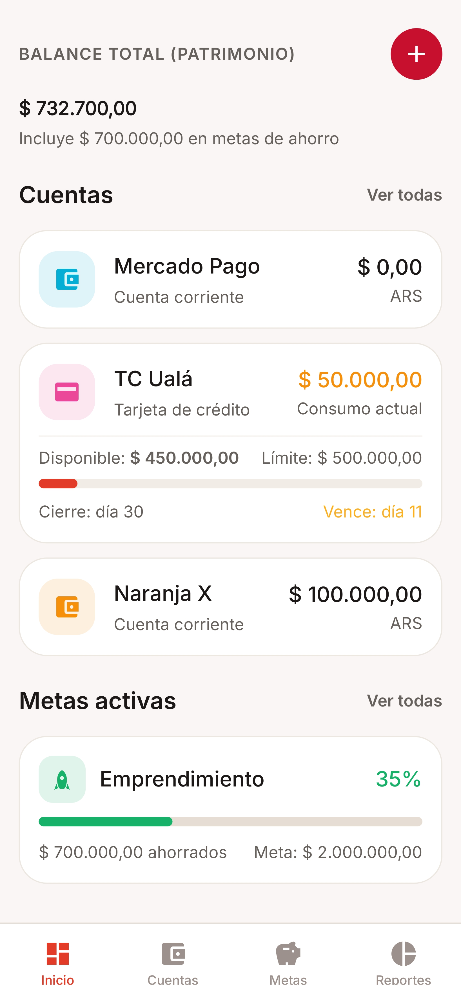

# 💰 UNPO: Finanzas (Finanzas Dashboard)

Aplicación móvil multi-usuario de finanzas personales desarrollada con **React Native (Expo SDK 58)**, **NativeWind v4 (Tailwind CSS)**, autenticación con **Firebase Auth** y backend serverless en **Cloudflare Workers** con base de datos SQLite distribuida en **Cloudflare D1**.

---

## 📱 Vista Previa



---

## ✨ Características Principales

- **Dashboard Resumen**:
  - Visualiza tu **Patrimonio Neto Total** y **Dinero Disponible** (incorporando ahorros en metas y descontando automáticamente saldos negativos en cuentas o deudas de tarjetas de crédito).
  - **Distribución de Fondos en 3 Vías**: visualización clara y vertical de dinero *Disponible* (libre de deudas), *Reservado* (en metas de ahorro activas) y *Comprometido* (gastos automáticos pendientes del mes y deuda de tarjetas).
  - **Presupuestos Mensuales por Categoría**: establece límites de gasto mensual por rubro con barras de progreso dinámicas (`<80%`: verde, `80-99%`: amarillo, `>=100%`: rojo) y alertas locales automáticas al 80% y 100%.
  - Vista rápida de **Cuentas**, **Metas activas**, **Gastos e Ingresos Automáticos**, y panel de **Información del Sistema y Copias de Seguridad**.
- **📅 Pestaña Calendario de Vencimientos (`/(tabs)/calendar`)**:
  - Vista dual: **Agenda (Línea de tiempo)** agrupada por día y **Cuadrícula mensual interactiva** con puntos indicadores por tipo de evento (verde para ingresos, rojo para gastos/cuotas, ámbar para cierres y vencimientos de tarjeta).
  - Resumen consolidado del mes con importes de ancho completo: *Ingresos previstos*, *Gastos y tarjetas* y *Balance neto estimado*.
  - Filtros rápidos en cabecera: *Todos*, *Gastos*, *Ingresos*, *Tarjetas y cuotas*.
- **💳 Tarjetas de Crédito, Cuotas y Resúmenes (`/accounts/[id]`)**:
  - **Compras en cuotas con cálculo financiero**: simulador y registro de compras en cuotas con cálculo automático de recargo financiero e interés implícito respecto al precio de contado.
  - **Límite de crédito bancario disponible**: cálculo riguroso del cupo disponible (`Límite - Deuda actual - Cuotas futuras por vencer`).
  - **Gestión de Resúmenes de Cuenta**: generación y cierre de resúmenes de facturación mensuales, con opción de abonar saldo total o pagos parciales con actualización automática de cuentas de origen y deuda.
- **Gastos e Ingresos Automáticos (`/recurring`)**:
  - **2 pestañas unificadas**: *Gastos automáticos* (suscripciones, alquiler, servicios) e *Ingresos automáticos* (sueldo/trabajo, pensión, beca, aporte, alquiler cobrado, etc.) con selección de categoría, fecha, frecuencia (*Mensual*, *Anual*, *Semanal*) y cuenta asociada.
  - **Balance fijo mensual estimado**: cálculo en tiempo real del flujo neto entre ingresos fijos y gastos fijos activos.
  - **Modo Fijo vs. Modo Variable (`is_variable`)**:
    - **⚡ Monto Fijo (Automático)**: se descuenta o acredita automáticamente al llegar el día indicado y avanza la fecha al próximo ciclo.
    - **🔔 Monto Variable (Consultar)**: espera al día indicado y a la **hora personal configurada por cada usuario** (`user_settings.reminder_time`) para preguntar si el precio/ingreso cambió este mes o se mantiene igual, permitiendo actualizar opcionalmente el monto base para futuros meses.
- **Sistema de Notificaciones Móviles (`expo-notifications`)**:
  - **Tarjetas de crédito (Cierre y Vencimiento)**: notifica 1 día antes a la hora configurada por el usuario (`💳 Mañana cierra tu tarjeta...` con el consumo acumulado para revisar movimientos, y `📅 Mañana vence tu tarjeta...` con el saldo pendiente de pago para no olvidar abonarlo). Al tocar la notificación, abre directamente el detalle de la tarjeta.
  - **Aviso anticipado (1 día antes)**: notifica en el celular cuando mañana vas a cobrar un ingreso (`💰 Mañana cobras...`) o vence un gasto (`📅 Mañana vence...`).
  - **Aviso el día de vencimiento**: a la hora elegida por el usuario, envía una notificación interactiva (`🔔 ¿Cambió el precio de...?` para variables o `⚡ Hoy se acredita/descuenta...` para fijos) que al tocarse abre directamente el cuadro de confirmación en la app.
  - **Confirmación de ejecución automática**: notifica inmediatamente cuando un movimiento fijo fue acreditado o descontado.
- **🌙 Modo Oscuro por Usuario**:
  - Cada usuario puede activar el **modo oscuro** desde el Dashboard (botón ☀️/🌙 del encabezado o interruptor en *Información del sistema*). El cambio es instantáneo.
  - La preferencia se guarda **por cuenta en Cloudflare D1** (`user_settings.theme`, valores `light` | `dark`, **por defecto `light`**) y se aplica automáticamente al iniciar sesión en cualquier dispositivo.
  - **Estilos globales con variables CSS**: todos los colores (`surface`, `text`, `primary`, `success`, `danger`, `warning`) se definen una sola vez en [`src/theme/palettes.js`](src/theme/palettes.js) y NativeWind los resuelve en runtime, por lo que las clases (`bg-surface-900`, `text-text-primary`…) cambian solas con el tema.
- **Cuentas y Metas Compartidas (`UNPO-XXXX`)**:
  - Permite compartir tanto **Cuentas** como **Metas de Ahorro** con otros usuarios mediante **códigos de invitación temporales (`UNPO-XXXX`)** válidos por 24 horas.
  - **Registro de autoría (`author_name`)**: cada gasto, ingreso, aporte o retiro dentro de una cuenta o meta compartida muestra qué miembro lo realizó (`• 👤 Nombre`).
  - **Desglose de aportes por miembro**: en las metas compartidas se calcula automáticamente cuánto dinero neto y qué porcentaje del total ahorrado aportó cada participante.
  - **Control de acceso**: el propietario puede quitar miembros en cualquier momento y los invitados pueden abandonar la cuenta o meta compartida.
- **Reportes Interactivos y Estadísticas Avanzadas (`/(tabs)/reports`)**:
  - **Mensual**: desglose de ingresos y gastos con gráficos interactivos de Torta / Dona (SVG nativo).
  - **Comparativa Mes a Mes (MoM)**: análisis de variación nominal y porcentual de ingresos y gastos respecto al mes anterior.
  - **Detección de anomalías de gasto**: alerta automática cuando una categoría presenta un gasto inusualmente concentrado respecto al total del mes.
  - **Anual**: consolidado anual y evolución mes a mes.
  - **🔮 Proyección a Futuro con Cuotas**: curva interactiva a 12 meses, simulador con **3 escenarios** (*Ritmo actual*, *Ahorrador -15% gastos*, *Prudente +15% gastos*), desglose de **cuotas futuras comprometidas** a 3, 6 y 12 meses, e hitos de patrimonio estimado a **+3m, +6m, +1 año y +2 años**.
- **🛡️ Precisión Financiera en Centavos & Testing (`money.ts` + Jest)**:
  - Todas las operaciones monetarias del frontend, Worker y SQLite D1 se calculan en **centavos enteros (`INTEGER`)**, erradicando por diseño imprecisiones de punto flotante de IEEE 754.
  - Algoritmo bancario de reparto de cuotas (`splitInstallments`) que asigna centavos sobrantes a las primeras cuotas garantizando coincidencia al centavo exacto.
  - Suite de pruebas unitarias automatizadas con **Jest y `jest-expo`** (`npm test`).
- **💾 Copias de Seguridad & Resiliencia Offline**:
  - **Banner de conexión nativo (`expo-network`)**: aviso sutil e instantáneo en la cabecera cuando el dispositivo pierde acceso a internet.
  - **Exportar Backup JSON**: volcado completo y estructurado de cuentas, transacciones, presupuestos, metas, cuotas y gastos automáticos (`expo-file-system` / `expo-sharing` en móvil y descarga directa en Web).
  - **Exportar Transacciones a CSV**: compatible con Microsoft Excel y Google Sheets con codificación UTF-8 BOM.
  - **Restaurar Backup JSON**: selector nativo de archivos (`expo-document-picker`), validación de integridad de esquema y confirmación de restauración.
- **Seguridad Multicapa & Arquitectura Modular**:
  - **Autenticación Firebase (JWT RS256)**: verificación criptográfica de tokens en el Worker contra las claves públicas de Google.
  - **Row-Level Security (RLS)**: aislamiento estricto por `user_id` tanto en consultas del Worker como en los `TRIGGER` de SQLite D1 y validación de propiedad cruzada (`verifyAccountOwnership` / `verifyGoalOwnership`).
  - **Anti-XSS y Sanitización**: limpieza estricta de textos, identificadores, colores, íconos, montos y límite de payload JSON (16 KB), junto con cabeceras HTTP de seguridad (`CSP`, `HSTS`, `X-Content-Type-Options`, `X-Frame-Options`).
  - **Rate Limiting en 2 niveles**: límite por IP pre-autenticación (anti-DDoS) y límite por `userId` autenticado diferenciando lecturas y escrituras.
  - **Backend Serverless Modular**: Worker refactorizado y desacoplado en módulos especializados (`lib/` para auth, RLS, rate limiting, sanitización; `routes/` para cada dominio: cuentas, transacciones, metas, gastos automáticos, cuotas, presupuestos, reportes, usuarios y estadísticas).
- **Actualizaciones OTA Automáticas (`expo-updates` + EAS Workflows)**:
  - Descarga actualizaciones en segundo plano desde el canal `production` y muestra un banner superior (`"Nueva versión descargada y lista — Actualizar ahora"`) sin requerir reinstalar el APK para cambios de JS/UI.
- **Modo Offline / Mock integrado con Tree-Shaking**:
  - Puedes ejecutar y probar toda la aplicación de inmediato sin desplegar ningún backend (`EXPO_PUBLIC_USE_MOCK=true`).
  - En compilaciones para producción, el motor mock de más de 1.200 líneas se excluye automáticamente del paquete mediante importaciones dinámicas asíncronas.

---

## 🛠️ Stack Tecnológico

| Capa                        | Tecnología                                                                                                              |
| --------------------------- | ----------------------------------------------------------------------------------------------------------------------- |
| **Framework Móvil**         | [Expo SDK 58](https://expo.dev/) + [React Native 0.88](https://reactnative.dev/)                                        |
| **Enrutamiento**            | [Expo Router v4](https://docs.expo.dev/router/introduction/)                                                            |
| **Estilos**                 | [NativeWind v4](https://www.nativewind.dev/) (Tailwind CSS)                                                             |
| **Autenticación**           | [Firebase Authentication](https://firebase.google.com/docs/auth) (Email/Password + Google)                              |
| **Notificaciones**          | [Expo Notifications](https://docs.expo.dev/versions/v58.0.0/sdk/notifications/) (Canales Android + Triggers locales)    |
| **Actualizaciones OTA**     | [Expo Updates](https://docs.expo.dev/eas-update/introduction/) + EAS Workflows                                          |
| **Archivos y Red Nativa**   | `expo-file-system`, `expo-sharing`, `expo-document-picker`, `expo-network`                                              |
| **Pruebas Unitarias**       | [Jest](https://jestjs.io/) + [`jest-expo`](https://docs.expo.dev/develop/unit-testing/) (13 tests monetarios)            |
| **Estado del Servidor**     | [TanStack Query v5](https://tanstack.com/query/latest)                                                                  |
| **Estado del Cliente**      | [Zustand v5](https://github.com/pmndrs/zustand)                                                                         |
| **Backend & Base de Datos** | [Cloudflare Workers](https://workers.cloudflare.com/) + [Cloudflare D1](https://developers.cloudflare.com/d1/) (SQLite) |

---

## 🚀 Inicio Rápido

### 1. Clonar e instalar dependencias

```bash
git clone https://github.com/MasitasIA/FINANZAS_DASHBOARD_APP.git
cd FINANZAS_DASHBOARD_APP
npm install
```

### 2. Configurar variables de entorno

Copia el archivo de ejemplo y completa las variables de Firebase y la URL de tu Worker:

```bash
cp .env.example .env
```

---

## 🧪 Opción A: Probar en Modo Mock (Sin Backend)

En tu archivo `.env`, asegúrate de tener:

```env
EXPO_PUBLIC_USE_MOCK=true
```

Inicia la aplicación:

```bash
# Versión Web
npm run web

# O para Android / iOS:
npx expo start --clear
```

---

## ☁️ Opción B: Conectar con Cloudflare D1 + Worker

### 1. Iniciar sesión en Cloudflare Wrangler

```bash
npx wrangler login
```

### 2. Crear o inicializar la base de datos D1

```bash
npm run d1:init
```

### 3. Desplegar el Worker

```bash
npm run worker:deploy
```

### 4. Configurar `.env` para usar el Backend Real

```env
EXPO_PUBLIC_USE_MOCK=false
EXPO_PUBLIC_API_URL=https://finanzas-worker.tu-subdominio.workers.dev
```

---

## 📦 Compilación APK y Actualizaciones OTA

- **Actualización OTA (solo cambios en JS, pantallas, estilos o lógica)**:
  - Al hacer `git push` a la rama `main`, el workflow `.eas/workflows/update.yml` publica automáticamente la actualización en el canal `production`.
  - También puedes publicarla manualmente:

    ```bash
    npx eas-cli update --channel production --message "Descripción del cambio"
    ```

- **Nueva compilación nativa APK (cuando se agregan librerías nativas nuevas en `package.json` o `app.json`)**:

  ```bash
  npx eas-cli build -p android --profile production
  ```

---

## 📜 Scripts Disponibles

```bash
npm run web            # Inicia la aplicación en el navegador web
npm run android        # Inicia la aplicación en Android
npm test               # Ejecuta las pruebas unitarias de precisión financiera con Jest
npm run lint           # Ejecuta el linter (expo lint)
npm run worker:dev     # Ejecuta el Cloudflare Worker en modo local
npm run worker:deploy  # Despliega el backend a Cloudflare Workers
npm run d1:init        # Ejecuta schema.sql en la base de datos remota D1
npm run d1:init:local  # Ejecuta schema.sql en la base de datos local D1
```

---

## 📄 Licencia

Este proyecto está bajo la Licencia MIT.
